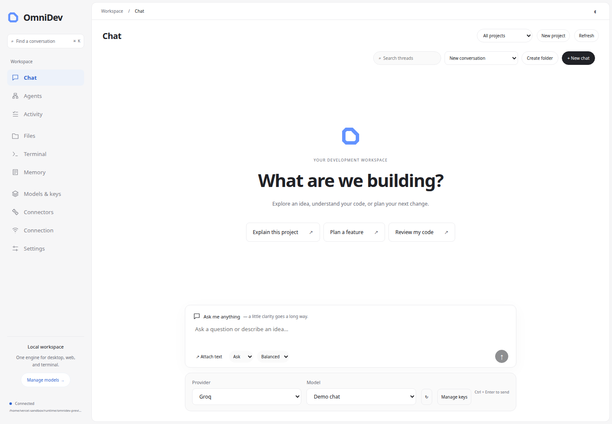

<!-- coderabbit-ai-generated:v1 -->

<!-- coderabbit-ai-generated-section:v1:74e8888e34218bdd717d18aab8c6579f8c44a387de90c1d9a95a9b72342a8ea8 -->

<!-- coderabbit-ai-generated-section:v1:f8325b3abfdefdbb7b6428bd43de70860519386df365425d0a7732113098b3cc -->

# OmniDev

<!-- coderabbit-ai-generated:v1 -->

<!-- coderabbit-ai-generated-section:v1:091192df0b373cf838f63de91b1dac91c6b3c831eb976ee00f16f1b668470afa -->

A local development environment with a FastAPI/SQLite engine, a React web workbench, a Tauri desktop client, and an installed `omnidev` CLI.

[](https://github.com/notgamermx/OmniDev/releases/latest/download/OmniDev-Windows-x64.msi)

```if it's not working scroll```

[](https://github.com/notgamermx/OmniDev/actions/workflows/ci.yml)

Download the MSI from [GitHub Releases](https://github.com/notgamermx/OmniDev/releases), install it, then search for **OmniDev** in Start. Releases also include the portable CLI ZIP, the `omnidev` Python wheel, Linux desktop package, and checksums. The download button becomes available after the first tagged release finishes CI.



<!-- /coderabbit-ai-generated:v1 -->

[Download Artifact](https://github.com/notgamermx/OmniDev/actions/runs/42362034188/artifacts/13570233253)

<!-- coderabbit-ai-generated:v1 -->

<!-- coderabbit-ai-generated-section:v1:f8b76e5890f7dd6b5b5645720aaaaf6372f4032157a44fd3ebf6b8efdd520558 -->

## Windows, gateways and personalization

<!-- coderabbit-ai-generated:v1 -->

<!-- coderabbit-ai-generated-section:v1:125f8e337df73207f35d58543e1e867ff2620e33f04f45db8666f286d36acc4f -->

For Windows installation, the bundled desktop/CLI build and source startup, see [Windows guide](docs/WINDOWS.md). GitHub Actions produces an MSI installer with a Start menu shortcut and an optional portable CLI ZIP. Install the MSI, then search for OmniDev in Start. The v1.0.1 Windows MSI passed installation, Start menu, startup, and engine lifecycle checks in [CI run 42362034188](https://github.com/notgamermx/OmniDev/actions/runs/42362034188). Version 1.0.2 requires a new CI pass before release.

<!-- /coderabbit-ai-generated:v1 -->

<!-- coderabbit-ai-generated:v1 -->

<!-- coderabbit-ai-generated-section:v1:160f930e984d61e821f2872fa47e991822de48edf06f418a425305d010b80566 -->

The workbench uses a minimal layout with no profile section and supports themes, accents, density, fonts and response preferences. **Models** includes provider key setup, live model browsing and a built-in fallback router shared by chat, agents and CLI. **Connectors** remains available for optional external gateways and command harnesses. See the [model and connector guide](docs/CONNECTORS.md).

<!-- /coderabbit-ai-generated:v1 -->

## Start from source

<!-- /coderabbit-ai-generated:v1 -->

Requires Python 3.12 and Node.js 22 or newer.

```bash
python3.12 scripts/setup.py
source .venv/bin/activate
cp .env.example .env
npm ci --prefix apps/desktop/renderer
npm --prefix apps/desktop/renderer run build
omnidev serve
```

Open **http://127.0.0.1:8000/app/**. `serve` applies migrations before startup. The API reference is at `/docs`. Windows activation: `.venv\Scripts\Activate.ps1`.

Set `PROJECT_ROOT` in `.env` to the directory the engine may edit. The default is `projects/`. File and task paths are relative to that directory. File tools reject paths outside this directory.

## Connect a model

<!-- coderabbit-ai-generated:v1 -->

<!-- coderabbit-ai-generated-section:v1:f1bf5598def1a461e7d532ba1174dacd01d8b6ca4d59b2b00d7532b86d858ac6 -->

Choose a provider and enter its model name in Chat or Agents. Built-in provider keys can be set in the engine's ignored `.env`. Connector keys can also be entered in the connection form: they are sent to the engine for encrypted storage and are not persisted in browser storage or returned by list APIs.

<!-- /coderabbit-ai-generated:v1 --> `omnidev providers` shows configuration status. Free tiers and quotas depend on the provider's current terms.

For local Ollama, install Ollama separately, pull a model (`ollama pull llama3.1:8b`), and run its service. The default endpoint is `http://localhost:11434/v1`. For an alternate compatible server:

```dotenv
PROVIDER_URLS={"ollama":"http://localhost:11434/v1"}
```

Chat streams responses; provider adapters retry transient failures and rate limits. Agent failover can be configured with `PROVIDER_FALLBACKS=[{"provider":"groq","model":"your-model"}]`. Every fallback needs its own credentials. Failover can send project context to those configured providers.

## Develop with an agent

1. Create a project and an agent in the workbench.
2. Select the agent's allowed tools. New agents default to read tools. Select `write_file` to edit and `git_commit` to commit.
3. Enable `TERMINAL_ENABLED=true` in `.env` and restart to allow shell commands and test execution. Shell commands require Docker and run in an isolated execution container.
4. Create a task with instructions and a verification command, for example `python -m unittest discover`.
5. Follow persisted thoughts, tool output, and verification in Tasks. A failed verification is returned to the agent for repair; completion requires the configured command to succeed. Execution is bounded by the step limit.

<!-- coderabbit-ai-generated:v1 -->

<!-- coderabbit-ai-generated-section:v1:b6c8df92e688cbad10e696628d9201a575e1adf7f94262426c933f61d9921914 -->

Files contains a UTF-8 editor with explicit Save. Terminal runs bounded commands and reports their exit status. It is a command console; shell state does not persist between commands. Conversations are saved on the engine and can be opened by desktop, web, or CLI. Session memory uses the selected conversation ID. Project memories are supplied to agents working on that project. Preferences and project understanding have REST endpoints.

### Downloads and provider troubleshooting

Use **Download** on a reply, **Download code** on a fenced code block, or **Download chat** to save the conversation as Markdown. Files downloads the editor's current contents, including unsaved changes. Tasks and Memory export JSON; Terminal exports its output as text. Models exports the discovered catalog and router configuration as JSON, without API keys. The desktop app opens a native Save dialog; the web dashboard uses your browser's downloads. Model catalog downloads contain metadata; local model weights are still installed through Ollama.

Provider failures show the provider name, HTTP status, a bounded explanation with configured credentials and echoed messages redacted, and a suggested next step. Refresh the catalog if a model is unavailable; check credentials for 401/403 and quotas for 429. For HTTP 400, check that the selected model supports chat and the conversation fits its context limit. OmniDev retries an explicitly rejected default temperature without that optional field, or replaces explicitly rejected `max_tokens` with `max_completion_tokens` when the provider asks for it. It preserves messages, model selection, and nondefault temperatures. Failed empty replies are omitted from saved conversation history.


<!-- /coderabbit-ai-generated:v1 -->

## CLI

```bash
omnidev health
omnidev providers
omnidev chat --provider ollama --model llama3.1:8b --interactive
omnidev chat --session SESSION_ID "Continue our conversation"
omnidev projects create --json '{"name":"My project"}'
omnidev agents create --json '{"name":"Builder","provider":"ollama","model":"llama3.1:8b","tool_names":["think","read_file","list_files","write_file","shell"]}'
omnidev tasks create --json '{"agent_id":1,"title":"Build a calculator","description":"Create it with tests","verification_command":"python -m unittest discover"}'
omnidev tasks run 1 --path .
omnidev tasks get 1
omnidev files .
omnidev read hello.py
omnidev write hello.py --from-file ./local-hello.py
omnidev terminal "python -m unittest discover"
omnidev memory set --session SESSION_ID --key language --value Python
```

Use `omnidev --help` and `omnidev COMMAND --help`. `OMNIDEV_URL` selects another engine; `OMNIDEV_TOKEN` supplies its access token.

## Desktop

The desktop application uses Tauri 2. Install [Tauri prerequisites](https://v2.tauri.app/start/prerequisites/) including Rust and your platform's native webview libraries.

```bash
npm ci --prefix apps/desktop
npm --prefix apps/desktop run dev
npm --prefix apps/desktop run build
```

Start the engine with `omnidev serve`, then open the desktop app. It uses the same engine and data as the web interface. Connection settings accept an engine URL and token. <!-- coderabbit-ai-generated:v1 -->

<!-- coderabbit-ai-generated-section:v1:88be0668bc902ee91cc97b93e132d04a05b5e31f9549572bc2c3be83bd971569 -->

Linux packaging produces a `.deb` with the desktop UI and uses a separately started Python engine. The Windows release build bundles the engine and CLI and starts its authenticated backend automatically; see the [Windows guide](docs/WINDOWS.md).

<!-- /coderabbit-ai-generated:v1 -->

## Remote access and shared use

An engine is one trusted workspace. Its API token grants full access to that workspace. Shared conversations are shared with all clients authorized to that engine; this is not a separate identity or per-user permission system. The older shared-session service is not exposed as an authorization mechanism.

Before listening outside loopback, set a unique `API_TOKEN` with at least 32 characters. Put a TLS reverse proxy in front of remote engines and explicitly configure `ALLOWED_ORIGINS` for the browser URL. Set `ENVIRONMENT=production`, `DEBUG=false`, and a unique `SECRET_KEY` of at least 32 characters. Provider credentials stay on the engine. The Connection screen retains the API token in session storage only.

## Release and verification

```bash
python scripts/release.py
pip install dist/omnidev-1.0.2-py3-none-any.whl
omnidev serve
python -m pytest backend/tests -q
```

The release script bundles the web build, CLI, migrations, and engine into the wheel. Installed builds store data under `~/.omnidev`; `OMNIDEV_HOME` overrides it. Back up this directory and `PROJECT_ROOT` before upgrades. A server restart marks interrupted running tasks as failed so they can be reviewed instead of silently replaying tools.

<!-- coderabbit-ai-generated:v1 -->

<!-- coderabbit-ai-generated-section:v1:5a3659f7843df938552fa1c48ed0b7fde2fbb20240385254447281414f0820ea -->

Python and JavaScript dependencies are independent of model access. Real cloud-provider calls require your credentials; local inference requires a running model service.

<!-- /coderabbit-ai-generated:v1 -->


<!-- /coderabbit-ai-generated:v1 -->

<!-- coderabbit-ai-generated:v1 -->

<!-- coderabbit-ai-generated-section:v1:75067436068164efc2e95c44cd909c0efaf222bd9926e7bbe4805e0539804bee -->

## License

OmniDev is licensed under the [MIT License](LICENSE).

## Execution boundaries and verification

<!-- /coderabbit-ai-generated:v1 -->

Build the execution image before enabling shell commands:

```bash
docker build -t omnidev-executor:1 -f containers/executor.Dockerfile containers
```

On Windows, run Docker Desktop with Linux containers. Docker must run on the same machine as the engine. Shell execution fails closed if Docker or the image is unavailable. The container mounts only the selected workspace, has no network or provider credentials, uses a read-only system filesystem, and has memory, CPU, process, time and output limits. Existing test inputs and Git metadata are mounted read-only. Install any required project dependencies in a custom image and set `EXECUTION_IMAGE`; package installation over the network is unavailable inside task containers. Keep secrets out of the selected workspace. Docker is a boundary, not a guarantee against container runtime vulnerabilities.

Existing tests and verification configuration are hashed before execution and checked between steps and before completion. Agent file writes to those original inputs are rejected. New tests can be created, but a passing command is only as strong as the checks the user selected; review the resulting source and new tests. Agent Git tools are blocked from invoking host Git; use the isolated shell for Git inspection and commit changes yourself after review. Custom harness installation and execution are explicit trusted host operations and are not container-isolated.

`COMMAND_OUTPUT_BYTES` defaults to 32,000, `TASK_TIMEOUT_SECONDS` to 900, and `TASK_TOKEN_BUDGET` to 100,000. <!-- coderabbit-ai-generated:v1 -->

<!-- coderabbit-ai-generated-section:v1:00c094b1f2e4a1f5b6ffdc6340e0528c5b3d304ef5c3dedb6e5d56959e6627e8 -->

The token budget conservatively reserves UTF-8 input bytes plus maximum response tokens before every engine planning call, including top-level failover. Internal provider/router retries may incur additional usage.

<!-- /coderabbit-ai-generated:v1 --> It is not a currency budget or a provider billing guarantee. Shell commands are limited to 120 seconds and containers are removed on timeout or cancellation. Files, memory and tool output are untrusted reference material: their instructions must not override the user's task.

## Publish a release

After reviewing the changes and passing CI, create and push a version tag matching `pyproject.toml` and the desktop manifests:

```bash
git tag -a v1.0.2 -m "OmniDev 1.0.2"
git push origin v1.0.2
```

The tag workflow runs backend tests, builds desktop and Python packages, exercises the installed Windows app, and publishes assets to GitHub Releases only after all jobs succeed. `omnidev-1.0.2-py3-none-any.whl` replaces the earlier `personal_ai_dev` distribution. Uninstall `personal-ai-dev` before installing `omnidev` to avoid overlapping CLI files; back up your OmniDev data first. Repository topics: `ai-agents`, `fastapi`, `tauri`, `ollama`.


<!-- /coderabbit-ai-generated:v1 -->
